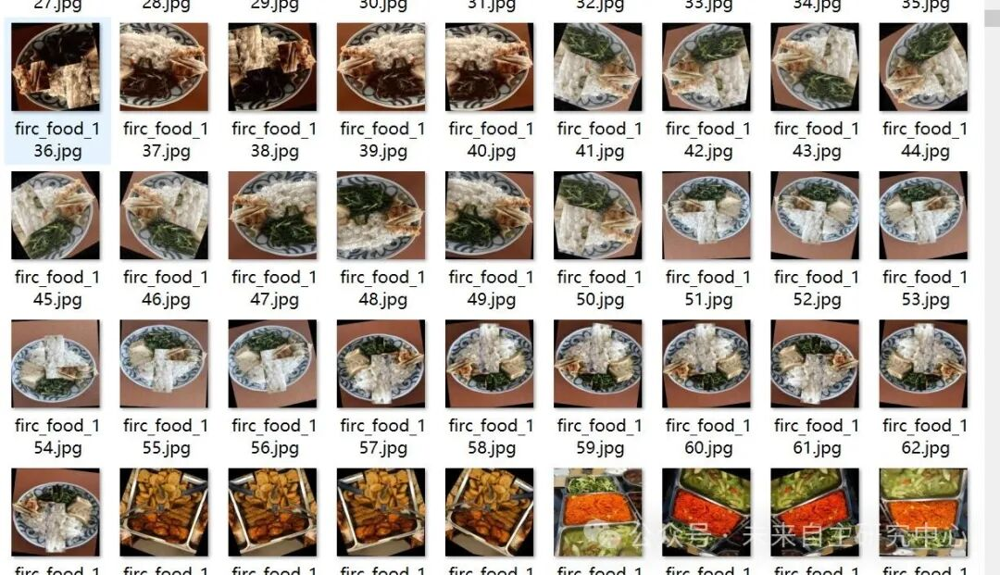
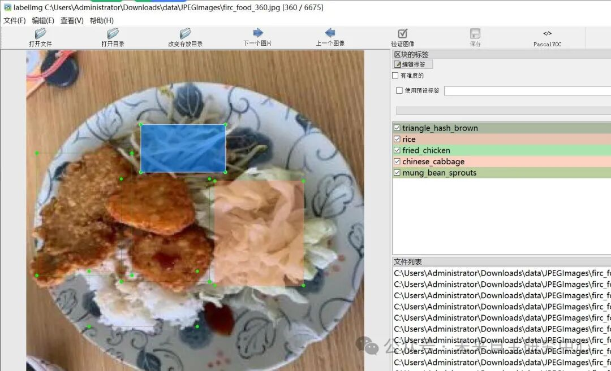

# Chinese fast food food detection dataset VOC+YOLO format with 6675 images and 36 categories

The dataset contains many enhanced images. Please confirm that they meet the requirements before downloading.

Dataset format: Pascal VOC format + YOLO format (txt file without split path, only containing jpg images and corresponding VOC format xml files and yolo format txt files)

Number of images (number of jpg files): 6675

Number of annotations (number of xml files): 6675

Number of annotations (number of txt files): 6675

Label count: 36

Label category names (note that the order of yolo format categories does not correspond to this, but is based on the labels folder's classes.txt): ["AW cola", "Beijing Beef", "Chow Mein", "Fried Rice", "Hashbrown", "Honey Walnut Shrimp", "Kung Pao Chicken", "String Bean Chicken Breast", "Super Greens", "The Original Orange Chicken", "White Steamed Rice", "black pepper rice bowl", "burger", "carrot_eggs", "cheese burger", "chicken waffle", "chicken_nuggets", "chinese_cabbage", "chinese_sausage", "crispy corn", "curry", "french fries", "fried chicken", "fried_chicken", "fried_dumplings", "fried_eggs", "mango chicken pocket", "mozza burger", "mung_bean_sprouts", "nugget", "perkedel", "rice", "sprite", "tostitos cheese dip sauce", "triangle_hash_brown", "water_spinach"]

Number of boxes labeled in each category:

AW cola frame count = 250

Beijing Beef Frames = 530

Chow Mein Frames = 108

Fried Rice Frames = 331

Hashbrown box count = 141

Honey Walnut Shrimp Frames = 233

Kung Pao Chicken Frames = 624

String Bean Chicken Breast Frames = 362

Super Greens Frame Count = 101

Original Orange Chicken Frames = 268

White Steamed Rice Frames = 692

Black pepper rice bowl frame count = 220

Burger frame count = 105

carrot_eggs Frame Count = 793

Cheeseburger frame count = 105

Chicken waffle frame count = 99

chicken_nuggets box count = 708

Chinese cabbage frame count = 1115

Chinese sausage box count = 1139

crispy corn frame count = 173

Curly braces = 758

French fries frame count = 231

Fried chicken frame count = 394

fried_chicken Frames = 1685

fried_dumplings box count = 621

fried_eggs Frames = 1448

Mango Chicken Pocket frame count = 109

mozza burger frame count = 178

mung_bean_sprouts Frame Count = 1653

Nugget Frame Count = 130

Perkedel Frame Count = 374

Rice box count = 2499

Sprite frame count = 24

Tostitos cheese dip sauce box count = 20

triangle_hash_brown box count = 1197

water_spinach frame count = 1412

Total frame count: 20830

Using labelImg:

Annotation rules: Draw a rectangle around the category.

Important Notice: No

Special : This dataset does not guarantee the accuracy or precision of the trained models or weight files. The dataset is provided with accurate and reasonable annotations only.

Image Preview:

Annotation example:

## Payment

Here is a pay link on Stripe ( https://buy.stripe.com/3cs8yP7sY87d0vu9AB ). Please contact me lonlonago@foxmail.com after funding $89, and I will send you a complete data files , thank you!

